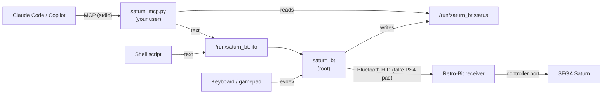

# How it works

## The big picture



The Retro-Bit receiver is a Bluetooth **host**: it searches for a controller and connects to it.
It only accepts certain controllers (Retro-Bit, PS4, Xbox One, Switch Pro).
`saturn_bt` makes the PC look like a **PS4 DualShock 4**, the simplest of those to imitate.

Two programs split the work:

| Program | Runs as | Job |
|---|---|---|
| `saturn_bt` (C++) | root | Bluetooth link, reading keyboard/gamepad, running commands |
| `saturn_mcp.py` (Python) | your user | MCP server for AI agents; validates commands and forwards them |

They talk through two files in `/run` (root-only directory, so nobody can tamper with them):

- `/run/saturn_bt.fifo`: a named pipe. Anyone can write commands to it; `saturn_bt` reads them.
- `/run/saturn_bt.status`: one line, the current state (`Connected.`, `Disconnected...`, `Visible as...`).

## Looking like a DualShock 4

The receiver decides whether a device is a PS4 controller from what it can see over Bluetooth:

| What | How it is set |
|---|---|
| Device class "gamepad" (`0x000508`) | `Class` in `/etc/bluetooth/main.conf` |
| Sony vendor/product ID (`054C:05C4`) | `DeviceID` in `/etc/bluetooth/main.conf` |
| Name "Wireless Controller" | adapter alias, set by `saturn_bt` at start |
| HID service record | registered by `saturn_bt` through BlueZ's `ProfileManager1.RegisterProfile` |

Bluetooth HID uses two L2CAP channels: **control** (PSM 17) and **interrupt** (PSM 19).
BlueZ's own input plugin normally owns those ports, which is why `bluetoothd` must run with `-P input`.

### Pairing and connecting

- **Without `-m`**: the PC stays discoverable and waits. When you press the receiver's pairing button,
  it finds "Wireless Controller", pairs, and opens both channels. After a disconnect, `saturn_bt` waits again.
- **With `-m MAC`**: `saturn_bt` connects to an already paired receiver itself, like a real pad waking up.

### Control channel

The receiver may ask questions before it accepts input. `ctrl_reply()` in `src/bridge.hpp` answers:

| Request | Reply |
|---|---|
| `GET_REPORT` (e.g. calibration 0x02, 0x05) | a zero-filled report of the real DS4 size, with CRC |
| `SET_REPORT`, `SET_PROTOCOL`, `SET_IDLE` | "OK" handshake |
| `GET_PROTOCOL` | "report mode" |
| virtual cable unplug | ends the session |
| anything else | "unsupported" handshake |

### Interrupt channel: the input report

`saturn_bt` sends DS4 input report `0x11` about every 10 ms, and immediately on every input change.
It is 79 bytes: the HID header `0xA1`, then 78 report bytes ending in a CRC-32 of everything before it.
Byte numbers below count from the report ID, as the code does (`MAP` uses the same numbers):

| Report byte | Content |
|---|---|
| 0 | report ID `0x11` |
| 1–2 | flags `0xC0 0x00` |
| 3–6 | left X/Y, right X/Y sticks, always centered (`0x80`) |
| 7 | D-pad (low 4 bits, 8 = released) + Square/Cross/Circle/Triangle |
| 8 | L1 R1 L2 R2 Share Options L3 R3 |
| 9 | PS button, touchpad click, 6-bit counter |
| 10–11 | L2 / R2 analog (0 or 255) |
| 74–77 | CRC-32 |

Rumble and lightbar messages from the receiver are read and ignored.

## Commands become steps

Each text command is turned into a list of steps by `parse()` in `src/bridge.hpp`:

```
press A+B 200  →  A down, B down, wait 200, A up, B up, wait 50
```

`saturn_bt` keeps a queue of steps and runs them as time passes, so waits are accurate to about 10 ms.
The 50 ms gap after each press makes sure two presses in a row register as two separate presses
(the Saturn reads the pad once per frame, about every 16 ms).

Commands and the physical keyboard share the same button state.
If a command holds A and you press and release the A key, A is released.

Commands written while the receiver is disconnected are thrown away when it reconnects,
so old commands never fire by surprise.

## Code map

| File | Contents |
|---|---|
| `src/bridge.hpp` | Logic that does no I/O: button tables, command parser, report builder, control replies, CRC |
| `src/saturn_bt.cpp` | Bluetooth (BlueZ D-Bus + L2CAP sockets), input device, pipe, main loop |
| `src/saturn_mcp.py` | MCP server: `status` and `send_commands` tools |
| `tests/test_bridge.cpp` | Tests for `bridge.hpp` |
| `tests/test_saturn_mcp.py` | Tests for the MCP server |

See [development.md](development.md) to change mappings or add buttons.
